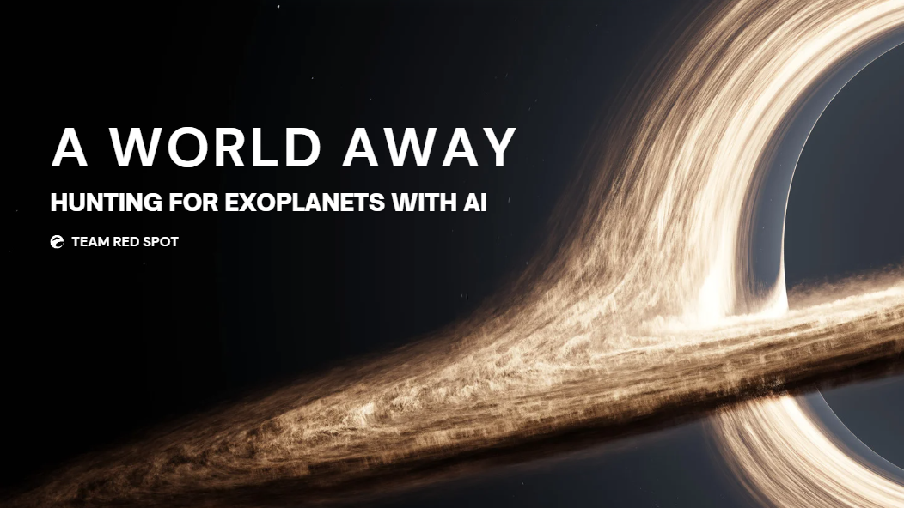
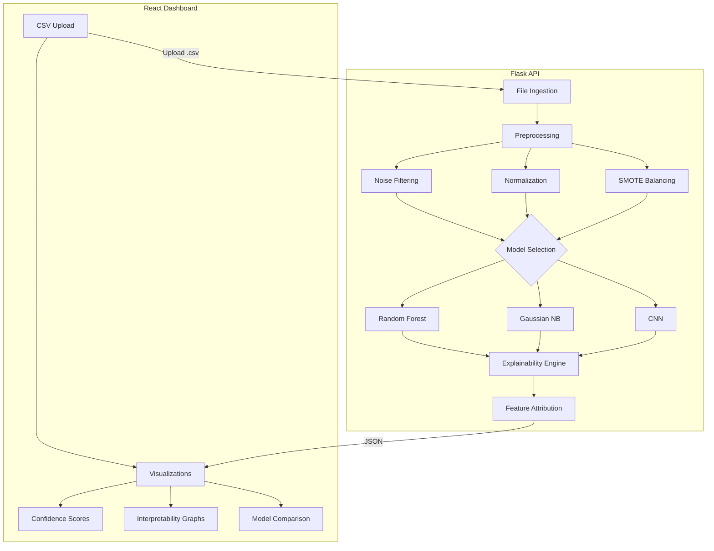

# Project Rosetta

Explainable AI system for exoplanet detection from stellar light curve data, built for the NASA Space Apps Challenge 2025.

<p align="center">
  
</p>

## Overview

Project Rosetta detects potential exoplanets from stellar flux data recorded by the Kepler and TESS telescopes. Unlike typical black-box classifiers, Rosetta generates explainability reports showing which features and time steps influenced each prediction, making the AI reasoning transparent to scientists.

Literature Survey: [Notion](https://www.notion.so/Literature-Survey-282ee35adcd580eba492e651450392cf?source=copy_link)



## Features

- **Multi-model classification**: Random Forest, Gaussian Naive Bayes, and CNN
- **Explainable AI**: Feature-level attribution reports per prediction
- **Dual-mode dashboard**: Toggle between CNN and ML explainers for comparison
- **SMOTE balancing**: Handles extreme exoplanet/non-exoplanet class imbalance
- **Interactive charts**: Confidence scores, light curves, and interpretability plots via Chart.js
- **Mission control UI**: Space-themed interface for researchers and students

## Dataset

| Property | Value |
|:--|:--|
| Source | NASA Kepler Labeled Time Series |
| Task | Binary classification (exoplanet vs non-exoplanet) |
| Challenge | Extreme class imbalance |

## Quick Start

```bash
# Backend
cd backend
pip install -r ../frontend/requirements.txt
python server.py

# Frontend
cd frontend
npm install && npm run dev

# ML notebooks
jupyter notebook backend/mystery-planet-99-8-cnn.ipynb
jupyter notebook Project-Rosetta-ML-Techniques.ipynb
```

## Project Structure

```
Project-Rosetta/
├── backend/
│   ├── server.py                      # Flask REST API
│   ├── predict.py                     # Prediction pipeline
│   ├── exoplanet_model.h5             # Trained weights
│   ├── preprocessing_params.pkl
│   ├── mystery-planet-99-8-cnn.ipynb  # CNN training (99.8% acc)
│   └── exoplanet-nasa (2).ipynb       # EDA notebook
├── frontend/
│   ├── src/components/
│   │   ├── Dashboard.jsx
│   │   ├── DataUpload.jsx
│   │   ├── VisualizationPanels.jsx
│   │   ├── ExplainabilitySection.jsx
│   │   ├── Hero.jsx
│   │   └── StarField.jsx
│   ├── app.py
│   └── package.json
├── Project-Rosetta-ML-Techniques.ipynb
├── NASA-PPT1.pdf
└── README.md
```

## Tech Stack

- **ML/DL**: TensorFlow/Keras, scikit-learn, imbalanced-learn (SMOTE)
- **Backend**: Flask, Python
- **Frontend**: React, Tailwind CSS, Framer Motion, Chart.js
- **Explainability**: Custom Gaussian NB feature attribution

## Team

| Name | Affiliation |
|:--|:--|
| S Akash | EE @ IIT Patna |
| Faizan Khan | PH @ IIT Delhi |
| Priyanshu | CS @ GGSIPU |
| Sobia Raza | Aero @ Amity |
| Midushi | CS @ IGDTW |

## License

Developed for the NASA Space Apps Challenge 2025.
